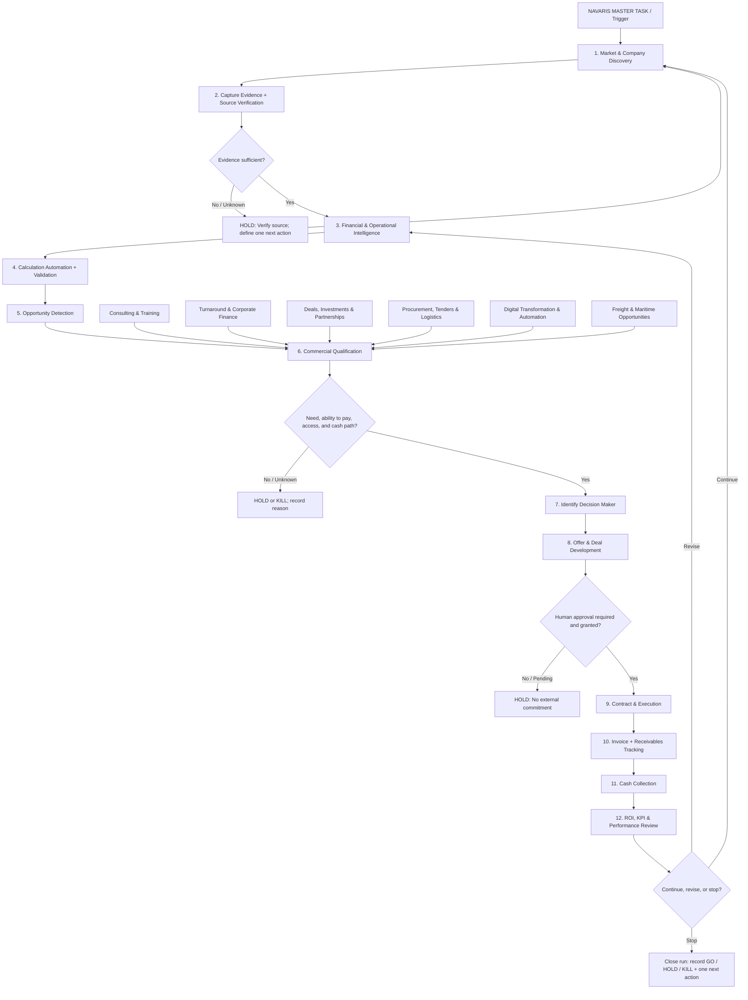

# NAVARIS Master Workflow
**Owner:** Mohamed Hafez | NAVARIS | Business Operations & Development  
**Primary KPI:** CASH COLLECTED  
**Status:** Workflow specification — documentation does not itself deploy or run automations.

## 1. Purpose
Connect market discovery, evidence-backed analysis, opportunity qualification, service/deal development, execution, invoicing, cash collection, and performance review in one controlled operating loop.

The workflow is designed to support NAVARIS's cash-first operating philosophy. It must not optimize for research volume or dashboards without a defined commercial action.

## 2. Corrected master flowchart

The original Mermaid snippet is syntactically valid. The main issue is logical completeness: it does not show evidence gates, GO/HOLD/KILL decisions, human approval, calculation/validation steps, or exception handling. This version adds those controls and makes specialist workstreams converge on opportunity qualification.

## 3. Operating sequence
1. **Discover:** Identify a company, market need, tender, buyer request, supplier opportunity, or project.
2. **Verify:** Record a source URL, publication date, retrieval date, source type, and evidence excerpt/reference. Unknown data remains UNKNOWN.
3. **Analyze:** Perform financial, operational, market, supplier, and risk analysis appropriate to the opportunity.
4. **Calculate:** Run deterministic formulas, validate inputs, expose assumptions, and record formula/version and output.
5. **Detect opportunity:** State the problem, affected party, evidence, proposed value, and commercial path.
6. **Qualify:** Check need, ability/willingness to pay, decision-maker access, feasibility, risk, and expected time to cash.
7. **Develop offer:** Define scope, deliverables, price basis, costs, payment milestones, exclusions, and next action.
8. **Human gate:** Obtain explicit human review before sending external messages, RFQs/tenders, quotations, contracts, purchase orders, investments, or commercial commitments.
9. **Execute and collect:** Track milestones, contract value, invoices, due dates, cash received, and outstanding balances separately.
10. **Review:** Measure conversion, cycle time, margin, cash collected, and lessons; continue, revise, or stop.

## 4. Calculation Automation requirements
Every calculation must preserve:
- Input values, units, currency, period, and source.
- Formula name/version and calculation timestamp.
- Explicit assumptions and any manual overrides.
- Validation results, missing-data warnings, and denominator/zero checks.
- Reproducible output and reviewer status.

Core examples:
- Revenue growth = (Current-period revenue / Prior-period revenue) - 1.
- Gross margin = Gross profit / Revenue.
- Operating margin = Operating profit / Revenue.
- Operating expense ratio = Operating expenses / Revenue.
- Working capital = Current assets - Current liabilities.
- Cash conversion indicator = Operating cash flow / Net income, only when the denominator is meaningful; interpret across periods and in context.
- Win rate = Won deals / Resolved qualified proposals; define treatment of cancelled and still-open proposals.
- Cash collected = cash actually received and reconciled, not contract value or invoiced revenue.

Never infer a company's willingness or ability to buy consulting solely from losses or expense ratios. Use financial indicators as screening evidence and verify commercial capacity separately.

## 5. Automation and AI agent boundaries
Suggested logical agents (implementation is separate):
- **Discovery Agent:** finds candidate companies, tenders, and demand signals.
- **Evidence Agent:** verifies source, date, identity, and evidence quality.
- **Financial Analysis Agent:** extracts/normalizes financial data and proposes calculations.
- **Calculation Engine:** deterministic code/formulas; the AI must not invent computed values.
- **Opportunity Scoring Agent:** applies documented criteria and flags missing inputs.
- **Commercial Research Agent:** identifies publicly available decision-maker/contact channels.
- **Offer Drafting Agent:** prepares draft offers and action plans for human review.
- **Execution & Cash Agent:** tracks approved milestones, invoices, receivables, and collections.
- **QA / Audit Agent:** checks citations, calculations, assumptions, duplicates, and run status.

AI agents may recommend or draft. They must not autonomously make external commitments, send commercial messages, issue quotes, sign contracts, purchase, or invest without the required human approval.

## 6. MCP server and plugins
Treat an MCP server as an integration layer for exposing approved tools/data to compatible clients; it is not itself the workflow engine or the AI model. Add a server only after documenting its repository, license, maintainer, permissions, secrets handling, supported tools, deployment method, and test results.

Plugin/integration selection checklist:
- Does it support a required business outcome?
- Is the repository active and maintained?
- Is the license compatible with intended use?
- Are dependencies and security issues reviewed?
- Does it require paid service, credentials, or external data sharing?
- Can it run locally/private where required?
- Is there a manual fallback?
- Has the integration been tested in a non-production environment?

Never commit API keys, tokens, passwords, client financial records, or private deal data to a public repository. Store secrets in GitHub Actions Secrets or an appropriate secret manager.

## 7. Run statuses and human questions
Each run must end with exactly one status:
- **GO:** evidence, fit, risk controls, owner, and a credible cash path are sufficiently established.
- **HOLD:** a material input, approval, source, or commercial condition is missing. Name the missing item.
- **KILL:** the opportunity fails a defined criterion or has no defensible commercial path. Record the reason.

Ask the owner only when an ambiguity materially changes scope, risk, cost, access, or external commitment. Each question must include:
1. The decision that is blocked.
2. What is known and what is unknown.
3. The recommended default.
4. Options with consequences.
5. Whether work can safely continue without the answer.

Do not pause for cosmetic preferences if a safe, reversible default exists. Do pause before destructive repository changes, production deployments, credential changes, paid services, or external commercial commitments.

## 8. GitHub implementation and validation checklist
- Keep this specification in version control and use pull requests for material architecture changes.
- Validate Mermaid rendering in GitHub Markdown preview.
- Add automated tests for calculation formulas, edge cases, missing values, currencies, and periods.
- Add schema validation for evidence and opportunity records.
- Add linting and tests to GitHub Actions only after the actual runtime/language is selected.
- Test integrations with synthetic data first.
- Record run ID, status, errors, evidence links, calculation outputs, reviewer, and one next action.
- Do not claim a workflow is deployed merely because its documentation or diagram exists.

## 9. Reference starting points
- Mermaid flowcharts: https://mermaid.js.org/syntax/flowchart.html
- GitHub Mermaid diagrams: https://docs.github.com/en/get-started/writing-on-github/working-with-advanced-formatting/creating-diagrams
- Model Context Protocol: https://modelcontextprotocol.io/
- GitHub Actions: https://docs.github.com/en/actions
- IFRS Foundation: https://www.ifrs.org/
- Egyptian Exchange: https://www.egx.com.eg/
- Financial Regulatory Authority Egypt: https://fra.gov.eg/
